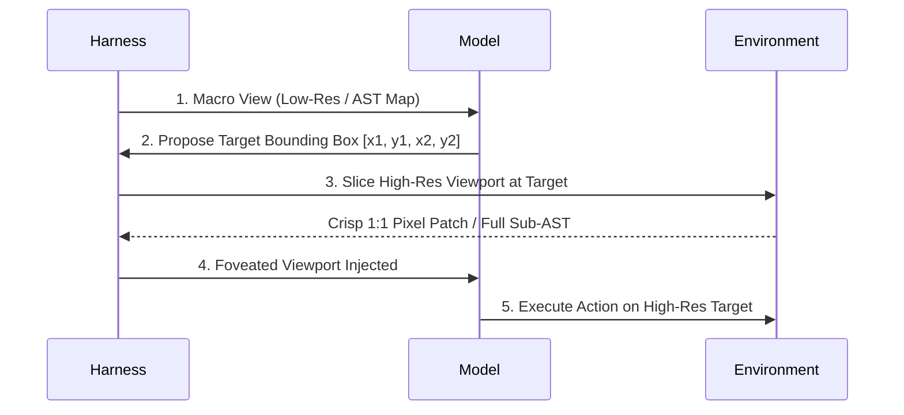
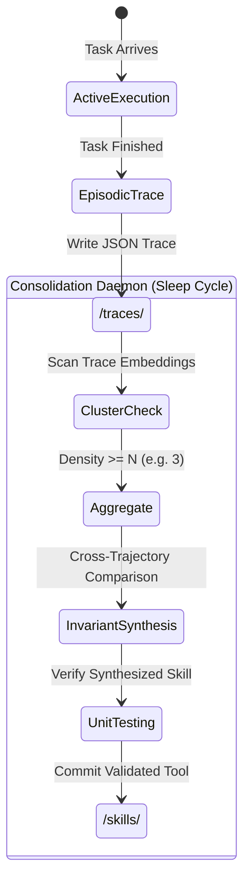

# Architecture Design Document: The Cognitive Harness (Reticle)

> Historical architecture, superseded as implementation direction on 2026-09-15 by
> [IMPLEMENTATION_PLAN.md](IMPLEMENTATION_PLAN.md). The mandatory cognitive rules and roadmap
> below are preserved as historical hypotheses, not requirements for new work.

## 1. Executive Summary & Philosophical Foundations

Current AI agent frameworks suffer from a fundamental mismatch between architecture and cognitive realities:
* **The Monolith Fallacy:** Relying on single-pass forward weights to handle perception, memory, taste, and execution simultaneously.
* **Append-Only Context Rot:** Treating the context window as a bottomless garbage dump rather than a fragile, high-cost working memory buffer.
* **Instant Habit Formation:** Attempting to turn single-shot successes into permanent skills, leading to rapid memory poisoning and library bloat.

This harness design applies **Systems Theory (Gall's Law)** and **Cognitive Neuroscience (Complementary Learning Systems & Predictive Coding)** to construct a lean, opinionated agent architecture optimized for **taste, parsimony, and compounding capability**.

---

## 2. Core Architectural Pillars

```
                                    +-----------------------+
                                    |    HUMAN / TASK       |
                                    +-----------+-----------+
                                                |
                                                v
+-----------------------------------------------------------------------------------+
| THE RUNTIME HARNESS                                                               |
|                                                                                   |
|  +---------------------------+        +----------------------------------------+  |
|  |    PERCEPTUAL ENGINE      |        |           COGNITIVE ENGINE             |  |
|  |                           |        |                                        |  |
|  | - Macro Sensor (Low-Res)  | ---->  | - Working Memory (Dynamic Context)     |  |
|  | - Fovea Tool (High-Res)   |        | - Epistemic Probes (Predictions)       |  |
|  | - Structural Transduction |        | - Two-Phase Loop: Make Work -> Prune   |  |
|  +---------------------------+        +-------------------+--------------------+  |
|                                                           |                       |
+-----------------------------------------------------------|-----------------------+
                                                            |
                 +------------------------------------------+--------------------+
                 | (Day: Trace Logging)                                          | (Night: Replay)
                 v                                                               v
+------------------------------------+                         +-----------------------------------+
| EPISODIC MEMORY                    |                         | PROCEDURAL MEMORY                 |
| (File System: /traces/)            | -- [Threshold N >= 3] -> | (File System: /skills/)           |
| Raw trajectories, lightweight logs |                         | Invariant, verified scripts/rules |
+------------------------------------+                         +-----------------------------------+
```

### Pillar I: Gall's Law & The Minimal Viable System
> *"A complex system that works is invariably found to have evolved from a simple system that worked."* — John Gall

The harness does not begin with complex graph abstractions, distributed queues, or multi-agent swarms. It starts as a simple, single-threaded execution loop with two rigid phase boundaries: **Make it work**, then **Make it elegant**.

### Pillar II: Foveated Multimodal Perception (Active Sensing)
Rather than dumping multi-megapixel canvases or full file trees into context:
* **Macro Peripheral Sensor:** Passes low-cost structural views (256x256 image or AST signature map).
* **Foveated Saccades (`inspect_region`):** The agent explicitly targets high-resolution queries only where uncertainty demands it.
* **Structural Invariant:** High-cost perceptual inputs are gated behind explicit target-selection steps, eliminating LLM overconfidence.

### Pillar III: Predictive Coding & Working Memory Pruning
* **Hypothesis Testing:** Before executing state-mutating actions, the agent commits to a minimal prediction tuple (`predict: { expected_delta }`).
* **Zero-Surprise Silence:** If reality matches prediction, the interaction is wiped from the active context.
* **Residual Logging:** Only prediction errors ($\Delta \ne 0$) leave an imprint, recorded as compressed belief updates.

### Pillar IV: Complementary Learning Systems (CLS Memory)
* **Working Memory (Context Window):** Highly volatile, strictly pruned, active reasoning workspace.
* **Episodic Memory (`/traces/`):** Append-only, lightweight logs of raw attempts, stored cheaply on the file system.
* **Procedural Memory (`/skills/`):** Crystallized muscle memory (Python scripts, deterministic recipes). **Never generated after a single trial.** Synthesized only when similar episodic traces cross a frequency threshold ($N \ge 3$).

---

## 3. Detailed Component Specifications

### 3.1 The Perception Engine (Reticle)



#### Sensorium Layers
1. **Coarse Layer:**
   * Images: Downscaled to $256 \times 256$ or $512 \times 512$ thumbnail.
   * Code: Tree-sitter / AST symbol outline (classes, signatures, no function bodies).
2. **Foveated Layer (`inspect_region`):**
   * Images: Bounded crop at native resolution.
   * Code: Targeted 50-line window around target symbol.

---

### 3.2 The Operational Loop: Two-Phase Execution

The core execution harness enforces an editorial barrier between **functional correctness** and **taste**:

```python
def run_loop(task: Task, env: Environment):
    context = initialize_context(task)
    
    # ==========================================
    # PHASE 1: GENERATIVE (Make it Work)
    # ==========================================
    while not task.solved():
        # Epistemic commitment
        prediction = model.predict_outcome(context)
        action = model.choose_action(context)
        
        # Actuation & Perception
        observation = env.execute(action)
        
        # Predictive Coding Check
        delta = compute_prediction_error(prediction, observation)
        if delta.is_zero():
            # State confirmed; evaporate the exchange to save tokens
            context.replace_last_step(summary="Step confirmed.")
        else:
            # Surprise encountered; record compressed belief update
            context.append_belief_update(delta.summary)
            
    # ==========================================
    # PHASE 2: COMPACTION (Make it Elegant / Taste Pass)
    # ==========================================
    critique_prompt = (
        "Functional requirements met. Inspect the solution diff.\n"
        "1. Remove redundant abstractions and single-use wrappers.\n"
        "2. Minimize cognitive load and token footprint.\n"
        "3. Preserve all passing invariants."
    )
    context.inject_system_directive(critique_prompt)
    optimized_diff = model.refactor(context)
    
    if env.verify_invariants(optimized_diff):
        env.apply(optimized_diff)
    else:
        env.rollback()
        
    # Log to episodic memory
    log_episodic_trace(task, context)
```

---

### 3.3 Memory Hierarchy & The "Sleep" Consolidation Engine



#### Episodic Trace Schema (`/traces/{id}.json`)
```json
{
  "trace_id": "tr_9824f1",
  "timestamp": "2026-09-13T19:55:00Z",
  "intent_cluster": "git_submodule_desync",
  "starting_state_hash": "a1b2c3d4",
  "actions_taken": [
    {"tool": "git_status", "args": []},
    {"tool": "inspect_region", "args": [".gitmodules"]},
    {"tool": "run_bash", "cmd": "git submodule update --init --recursive"}
  ],
  "failure_recovery_notes": "Direct checkout failed; needed sync first.",
  "success": true
}
```

#### The Consolidation Protocol (The "Dream" Pass)
Run periodically (cron or idle hook):
1. **Cluster:** Group traces in `/traces/` by semantic intent.
2. **Filter:** Discard clusters where $count < 3$. (One-off hacks remain inert).
3. **Cross-Trajectory Invariant Synthesis:**
   Prompt the consolidation model:
   > *"You have 3 separate traces solving '{intent}'. Identify the common invariant path. Discard all context-specific workarounds. Write a single, self-contained Python script or bash function with error handling."*
4. **Validation:** Execute the synthesized skill against a sandbox regression test.
5. **Crystallization:** Save to `/skills/{intent_slug}.py`.

---

## 4. Anti-Patterns & Risk Mitigations

| Failure Mode | Root Cause | Architectural Defense |
| :--- | :--- | :--- |
| **Context Explosion** | Ingesting full-res images or 5,000-line files | Mandatory coarse-first perception; high-res gated by `inspect_region`. |
| **Memory Poisoning** | Writing a skill immediately after 1 lucky run | $N \ge 3$ threshold before consolidation; cross-trajectory synthesis. |
| **Hindsight Rationalization** | LLM explains away errors post-hoc | Pre-action prediction commitment; explicit residual logging. |
| **Framework Bloat** | Trying to build distributed agent platforms | Single-file harness runtime; standard file system for all state. |

---

## 5. Solo Builder Implementation Roadmap

### Phase 1: The Minimal Loop (Completed)
- [x] Implement `harness.py`: Basic `while` loop with tool calling and token-budget limits.
- [x] Add **Phase 2 Compaction Pass**: Force an editorial diff-reduction step before returning results.
- [x] Two-Phase Generative & Compaction execution verified.

### Phase 2: Perceptual Foveation & Multi-File Scaling (Completed)
- [x] Build the two-level sensorium for code:
  - Macro: AST symbol outline (signatures, classes, line bounds without function bodies).
  - Micro: `saccade(start, end)` foveated bounded crop with margins.
- [x] Multi-file project outline navigation verified on `project_bench/` (6/6 tests passing).
- [x] Validated against 2.6B edge model (`liquid/lfm-2.5-2.6b:free`) vs unfoveated baseline.
- [x] Greenfield skeletal infill demonstrated on `greenfield_bench/`.

### Phase 3: Sleep & Consolidation (Next)
- [x] Structured episodic JSON logging to `./traces/`.
- [ ] Build `consolidate.py`: Cluster traces ($N \ge 3$) and synthesize invariant scripts into `./skills/*.py`.
- [ ] Add dynamic skill discovery to the harness prompt.

---

## 6. Perceptual Tooling Landscape & Cognitive Transducers

A fundamental premise of this architecture is that **raw instruments exist for free, but cognitive compression lenses must be custom-built**.

Existing open-source tools are designed for human eyes in an IDE or for compilers—not for token-constrained, attention-bounded LLMs. The role of the harness is to act as the **sensory cortex**, converting low-level sensor telemetry into compressed, high-signal belief states.

### 6.1 Modality Breakdown: Off-the-Shelf vs. Custom

| Modality | Free Off-the-Shelf Instruments | Custom Cognitive Transducer Needed |
| :--- | :--- | :--- |
| **Code & Text** | Python `ast`, Tree-sitter, LSP (`goto_def`, diagnostics), Ripgrep | **Salience Filter:** Decides which 90% of syntax nodes to prune, leaving only skeletal signatures and line indices (`perception.py`). |
| **Multimodal UI** | OpenCV, Pillow, OS Accessibility Trees (Playwright DOM, AT-SPI), Local OCR | **Foveated Visual Transducer:** Converts raw screen frame into a 200-token spatial grid + dynamic `inspect_region(box)` crop tool. |
| **Real-Time / Godot** | Godot 2D/3D physics, radial raycasts, collision areas, navigation meshes | **Semantic Aggregator:** Translates 60Hz continuous float vectors (`Vector2`) into discrete situational beliefs (`"Cover: High, Threat: Flanking North"`). |

### 6.2 The Strategic Value of the Transducer
Building custom perceptual transducers is the primary moat and value driver of the harness:
1. **Compute Asymmetry:** Mathematical operations (AST traversal, image downsampling, raycast filtering) run locally in microseconds at $0.00 cost.
2. **Context Compression:** Running a local transducer converts thousands of noisy tokens into ~100 tokens of pure signal.
3. **Capability Amplification:** As demonstrated empirically, a proper perceptual transducer allows an edge-sized 2.6B model to perform complex multi-file engineering tasks that usually cause even 70B models to hallucinate.
